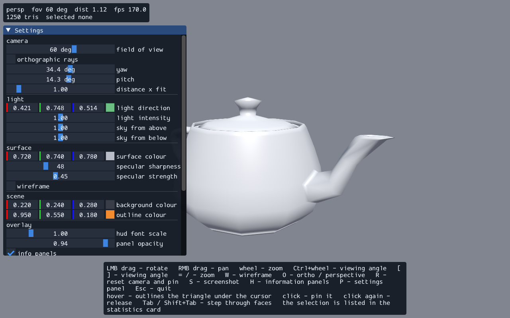

# pi-gyro-s64

**OBJ / GL viewer** — интерактивный просмотрщик Wavefront `.obj` на OpenGL 4.6 core, написанный на
C11 без внешних библиотек кроме GLFW и Dear ImGui. **Проект в стадии активной разработки**: это
рабочая дев-ветка, релизов и tag'ов нет, API и hotkeys могут меняться.



На скриншоте: Utah teapot (1250 граней), шейдинг с двумя light'ами, outline силуэта (edge-detected,
`id`-атрибут вместо stencil), выбранная грань, две панели HUD (статистика + подсказки hotkeys) с
маской под текстом.

## Что делает

- Загрузка `.obj` (triangulation, позиции + нормали, bbox-центрирование и fit по bounding radius).
- Orbit / pan / zoom camera, перспектива и ортография (`O`), auto-fit при загрузке.
- Шейдинг (ambient + diffuse + specular), билинейный filter для outline-сэмплеров.
- **Outline всего силуэта** без readback: edge detection + polygon-offset (`GL_EQUAL`), 2-pass.
- **Picking по face id**: `id`-атрибут + `discard` (главный pass) и `glReadPixels` для pick-pass;
  nearest-first по глубине. `Tab`/`Shift+Tab` — шаг по граням в порядке файла (циклический).
- **Идентификация грани в HUD**: ordinal авторской грани, 1-based номера вершин из `f`-строки,
  нормаль грани и нормали вершин (авторские `vn` либо computed, с оценкой отклонения).
- **Подсветка выбранной грани** без readback: uniform + `discard`.
- **HUD на Dear ImGui** (двухпанельный: статистика и подсказки), текст из атласа, контраст по WCAG.
- **Resizing окна рисуется сразу**: framebuffer size перечитывается в кадре, не в callback'е
  (`glfwPollEvents` на Windows во время drag'a окна не вызывается — repaint идёт из `WM_PAINT`).
- Offscreen-рендер в FBO и запись BMP без окна (`--render`, плюс `--yaw/--pitch/--fov/--ortho` для
  воспроизводимых кадров).
- **`--selftest`**: численные метрики вместо «на глаз» — coverage силуэта (> 2%), outline-пиксели
  (2–35% кадра, контраст ≥ 600), pick-пиксель в 20 px от центра, identity грани (ordinal +
  номера вершин + нормали), Tab-шаг, отсутствие чёрных пикселей после
  resize, gaps HUD ≤ 2 px, wrap подсказок. 10 разделов, 60 проверок, пороги относительные, чтобы
  пережить другой GPU/AA.

## Стек

| | |
|---|---|
| Язык | C11, `gcc -O2 -std=c11 -Wall -Wextra`, сборка без warning'ов |
| Графика | OpenGL 4.6 core, GLSL `#version 460 core`, GLFW 3.4 (static) |
| UI | Dear ImGui (backend `imgui_impl_glfw` + `imgui_impl_opengl3`) |
| Математика | свои `mat4`/`vec3` (`src/vmath.c`), без внешних math-libs |
| Загрузчик GL | ручной (`src/gl.c`): `glfwGetProcAddress` + свои typedef'ы, без `glad`/`glew` |
| Вывод кадров | свой BMP-writer (`src/img.c`), PNG конвертация пост-процессом |
| Platform | Windows (mingw-w64 / w64devkit, GCC 14.2); статический линк GLFW, mingw-специфичные линк-флаги |

Внешних зависимостей в `src/` нет: `deps/imgui` (vendored, MIT) и статический GLFW.

## Сборка и запуск

Нужен mingw-w64 (в этом окружении — w64devkit, GCC 14.2) со статическим GLFW 3.4
(`libglfw3.a` в lib-каталоге тулчейна) — GLFW линкуется через `-lglfw3`, в репозитории его нет.

```sh
make imgui      # на чистом клоне сначала: собирает vendored Dear ImGui (libcimgui.a)
make            # viewer.exe в корень репозитория (GCC + mingw-w64; линк GLFW/imgui статически)
make test       # selftest + tests/run_tests.ps1
```

Запускать нужно **из корня репозитория**: `assets/` и `shaders/` резолвятся относительно текущего
каталога (не относительно бинаря), поэтому `./viewer.exe` из `build/` не найдёт модель.

```sh
./viewer.exe                     # Utah teapot
./viewer.exe assets/cube.obj     # свой файл
./viewer.exe --render assets/cube.obj tests/out/frame.bmp 800 600   # offscreen BMP без окна
./viewer.exe --selftest          # 10 разделов, 60 численных проверок
```

### Управление

| Клавиша | Действие |
|---|---|
| ЛКМ drag | orbit (yaw/pitch, pitch clamp ±85°) |
| ПКМ drag | pan |
| Колесо | zoom (clamp по размеру модели) |
| `Ctrl` + колесо | viewing angle (fov), не дистанция |
| `[` / `]` | fov −5° / +5° (8–90°) |
| `=` / `-` | zoom +1 / −1 |
| `W` | wireframe overlay on/off |
| `O` | перспектива ↔ ортография |
| `R` | reset камеры (auto-fit по bounding radius) + снятие pin |
| `S` | screenshot BMP текущего кадра |
| hover | outline граней под курсором (nearest-first по глубине) |
| ЛКМ click | pin грани; повторный click на той же — снять pin |
| `Tab` / `Shift+Tab` | шаг по граням в порядке файла (циклический) |
| `Esc` | выход |

## Проверка

Публичная проверка — `make test`: сборка, `./viewer.exe --selftest` (10 разделов, 60 проверок, exit 0),
`tests/run_tests.ps1` (BMP-метрики: coverage, outline, picking, resize, wireframe, offscreen).
Проверки числовые; пороги относительные.

## Структура

```
src/         продукт (C11): obj, camera, vmath, mesh, shader, render, gl, img, hud, main
shaders/     GLSL 460 core
assets/      тестовые модели (cube, teapot)
tests/       PS1 + Python проверка пикселей
docs/        скриншот для README + отчёты шага (docs/reports/)
build/       замороженный scratch (git-ignored): бинаря продукта там нет, только временные файлы
             сборки (`*.o`) если понадобятся
lab/probes/  изолированные зонды ABI/GL/HUD — см. lab/probes/README.md
deps/imgui/  vendored Dear ImGui (MIT) + libcimgui.a
Roadmap.md   фазы E0…E7 и статусы
PROJECT_MEMORY.md  решения и факты окружения (ADR)
AGENTS.md    регламент разработки
```

## Как разрабатывается

Проект написан **ИИ в локальном окружении**, без ручной правки кода:

- **Harness:** [pi.dev](https://pi.dev) coding agent (TUI, сессии в `~/.pi/agent/sessions`).
- **Модель:** локальный Qwen-чекпоинт (provider `strata`, OpenAI-compatible endpoint на
  локальной машине).
- **Процесс:** новый функционал сначала проверяется isolated-прототипом в `lab/`, потом переносится
  в `src/`; каждый шаг сопровождается численной проверкой (пиксели, coverage, delta), без
  плейсхолдеров и без «зеленения» тестов; решения и факты окружения фиксируются в
  `PROJECT_MEMORY.md`, статусы работ — в `Roadmap.md`, регламент разработки — в `AGENTS.md`.

## Ограничения и open tasks

- Производительность на ~1M граней не замерена (задача E5.T4: счётчик кадров/сек на большой модели).
- Windows-only сборка: линк-флаги и `GLFW_EXPOSE_NATIVE_WIN32` специфичны для mingw.
- Рендер из `WM_PAINT` (repaint во время drag'а окна) требует сериализации с асинхронной загрузкой модели.
- `deps/imgui/build` содержит бинарные артефакты сборки (vendored); их можно пересобрать `make imgui`.

## Лицензия

MIT (см. `LICENSE`). Vendored'ные зависимости: Dear ImGui (MIT), GLFW (zlib).
